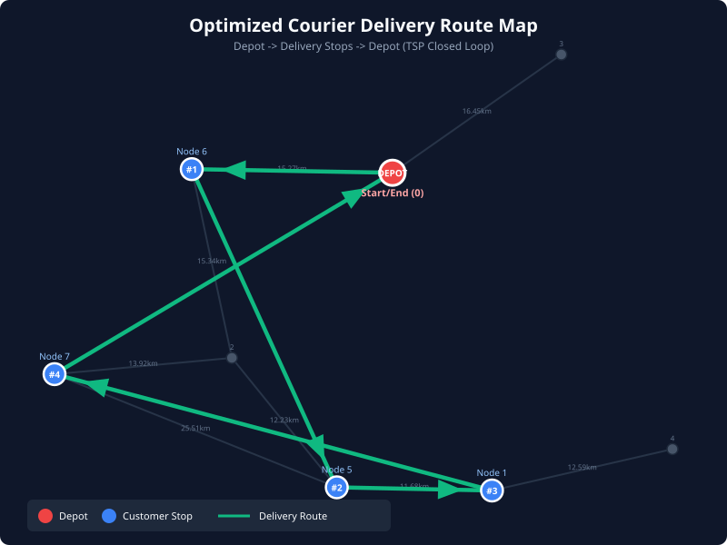

# Courier Delivery Logistics Optimizer
### Integrated Capstone Project: Sorting, Dynamic Programming Knapsack, Dijkstra's Algorithm, and TSP Route Maker



---

## 🌟 Project Overview
This repository contains an end-to-end Python application that solves the last-mile courier delivery planning problem. It combines fundamental computer science algorithms to prioritize parcels, optimize package selection under vehicle weight limits, compute shortest road network paths, and generate delivery routes that minimize transit distance.

### Key Capabilities:
- **Phase 1: Problem Design & Modeling**: Comprehensive modeling of parcel attributes, road graph topologies, and multi-stage algorithmic architecture.
- **Phase 2: Parcel Prioritization & 0/1 Knapsack Box Filling**: Multi-criteria sorting (Merge Sort vs. Quick Sort) and Dynamic Programming (0/1 Knapsack) to pack vehicles to 100% capacity utilization.
- **Phase 3: Route Maker & Graph Processing**: Dijkstra’s algorithm with binary min-heaps for point-to-point shortest paths, combined with Nearest-Neighbor TSP and 2-Opt local search refinement.
- **Phase 4: Performance Benchmarking & Scaling**: Empirical profiling across Small, Medium, Large, and Stress datasets, with SVG runtime charts and optimization analysis.
- **Phase 5: Interactive Demonstration & Reporting**: Interactive CLI (`main.py`), automated benchmarking suite (`benchmark.py`), HTML dashboard (`charts/dashboard.html`), and full academic report (`CAPSTONE_REPORT.md`).

---

## 📁 Repository Structure

```
├── Instructions.md             # Project requirements and rubric
├── README.md                   # Setup, execution guide, and system overview
├── CAPSTONE_REPORT.md          # Comprehensive final academic evaluation report
├── requirements.txt            # System dependencies (Standard library only; zero pip requirements)
├── main.py                     # Interactive CLI application
├── benchmark.py                # Automated benchmarking & chart generation script
├── generate_all_datasets.py    # Synthetic dataset generator
├── src/                        # Core algorithmic engine
│   ├── __init__.py
│   ├── models.py               # Parcel, RoadGraph, PackingResult, RouteResult models
│   ├── pipeline.py             # End-to-end logistics optimization pipeline
│   ├── visualization.py        # SVG charts, HTML dashboard, and ASCII formatters
│   ├── dataset_generator.py    # Road network and parcel pool synthesis
│   └── algorithms/
│       ├── __init__.py
│       ├── sorting.py          # Merge Sort, Quick Sort (3-way partition), Timsort
│       ├── knapsack.py         # 0/1 Knapsack DP with full table and backtracking
│       ├── dijkstra.py         # Dijkstra shortest path with min-heap priority queue
│       └── tsp.py              # Nearest-Neighbor TSP + 2-Opt refinement + Brute Force
├── data/                       # Sample datasets (JSON and CSV formats)
│   ├── small_dataset.json / .csv   (15 parcels, 8 nodes, 35 kg capacity)
│   ├── medium_dataset.json / .csv  (100 parcels, 25 nodes, 120 kg capacity)
│   ├── large_dataset.json / .csv   (500 parcels, 50 nodes, 350 kg capacity)
│   ├── stress_dataset.json / .csv  (1000 parcels, 80 nodes, 600 kg capacity)
│   └── city_graph.json
├── charts/                     # Generated charts & dashboards
│   ├── runtime_comparison.svg  # Multi-series runtime bar chart
│   ├── route_visualization.svg # Road network and delivery route topology map
│   └── dashboard.html          # Interactive standalone HTML dashboard
├── docs/                       # Detailed phase documentation and execution traces
│   ├── PHASE_1_DESIGN.md
│   ├── PHASE_2_PACKING.md
│   ├── PHASE_3_ROUTING.md
│   ├── PHASE_4_PERFORMANCE.md
│   └── output_traces.txt       # Raw execution trace from benchmark runs
└── tests/                      # Automated unit and integration test suite
    ├── __init__.py
    ├── test_sorting.py
    ├── test_knapsack.py
    ├── test_dijkstra.py
    ├── test_tsp.py
    └── test_pipeline.py
```

---

## 🚀 Execution Steps

### 1. Requirements & Prerequisites
The project is built using Python 3.8+ **standard library**. No third-party packages are required to run the core application, tests, or generate the SVG charts and HTML dashboards.

```bash
# Verify Python version
python3 --version
```

### 2. Run the Interactive CLI (`main.py`)
Run the optimizer on any dataset scale with custom options:

```bash
# Run on the Small dataset (default)
python3 main.py

# Run on the Medium dataset with 120 kg capacity
python3 main.py --dataset medium

# Run on the Large dataset with Quick Sort and export HTML dashboard
python3 main.py --dataset large --sort-algorithm quick_sort --export-html charts/dashboard.html

# View all available CLI options
python3 main.py --help
```

### 3. Run Automated Benchmarks & Generate Charts (`benchmark.py`)
Executes the pipeline across all 4 dataset scales (Small, Medium, Large, Stress), validates DP tables, compares TSP against exact Brute Force, generates SVG charts, and updates `docs/output_traces.txt`:

```bash
python3 benchmark.py
```

### 4. Run the Unit Test Suite
Run the 13 automated unit and integration tests:

```bash
python3 -m unittest discover tests
```

---

## 📊 Summary of Benchmark Results

| Dataset | Parcels ($N$) | Nodes ($V$) | Packed Weight | Packed Value | Route Length (km) | 2-Opt Gain | Total Runtime |
| :--- | :--- | :--- | :--- | :--- | :--- | :--- | :--- |
| **Small** | 15 | 8 | 35 / 35 kg (100%) | 762 | 136.24 km | **0.0% (Global Opt)** | **0.15 ms** |
| **Medium** | 100 | 25 | 120 / 120 kg (100%) | 5,088 | 293.23 km | **9.28%** | **1.60 ms** |
| **Large** | 500 | 50 | 350 / 350 kg (100%) | 18,157 | 351.28 km | **15.49%** | **16.02 ms** |
| **Stress** | 1000 | 80 | 600 / 600 kg (100%) | 32,315 | 411.20 km | **16.07%** | **48.63 ms** |

---

## 📈 Visualizations & Artifacts
- **Runtime Performance Chart**: [charts/runtime_comparison.svg](charts/runtime_comparison.svg)
- **Delivery Route Map**: [charts/route_visualization.svg](charts/route_visualization.svg)
- **Interactive Dashboard**: [charts/dashboard.html](charts/dashboard.html)
- **Execution Traces**: [docs/output_traces.txt](docs/output_traces.txt)
- **Full Academic Report**: [CAPSTONE_REPORT.md](CAPSTONE_REPORT.md)
